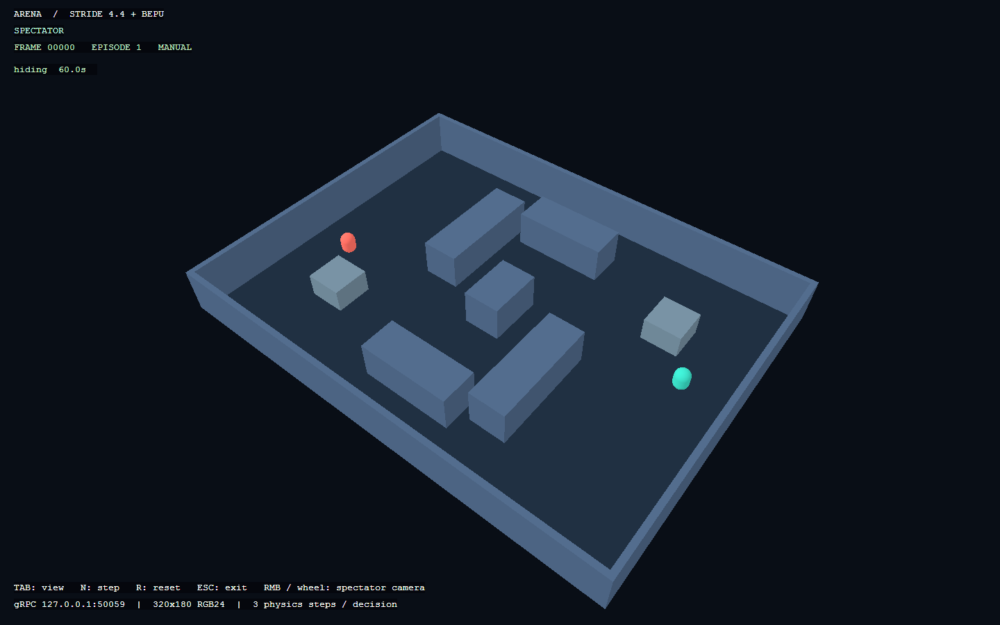
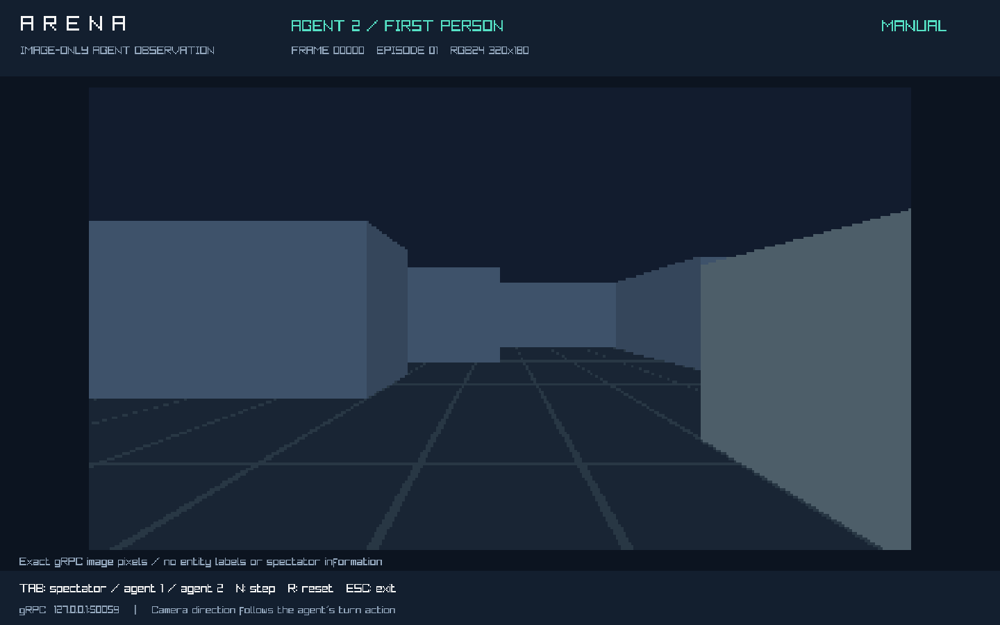
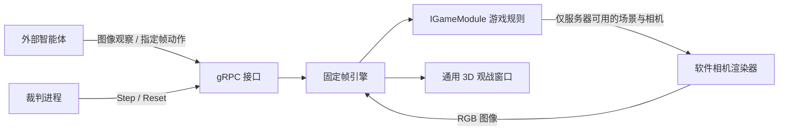

# Arena：面向智能体比赛的 C# 游戏引擎原型

这是一个可运行的可行性 demo：**固定帧模拟 + 3D 观战 + 纯图像智能体观察 + gRPC 控制**。第一款示例游戏是 3D 躲猫猫。引擎核心、渲染器和协议独立于躲猫猫规则，后续比赛可以替换游戏模块。

技术栈：.NET 10 / C#、Raylib-cs 8.1（观战窗口）、C# 软件 3D 相机（智能体图像）、ASP.NET Core gRPC、Protocol Buffers、xUnit。无需安装 Unity、素材编辑器或额外模型资源。图形由代码创建；首次构建需要联网下载 NuGet 包。

## 快速运行

要求：.NET 10 SDK；窗口模式需要桌面和支持 OpenGL 3.3 的显卡/驱动。当前开发环境是 Windows x64。无窗口模式也会生成智能体图像，使用 CPU，不需要 OpenGL 上下文。

在项目根目录运行：

```powershell
dotnet build Arena.slnx
dotnet run --project src/Arena.Demo
```

窗口中红色是寻找者，绿色是躲藏者。默认双方由简单内置策略控制，直接启动就能观察一局游戏。逻辑默认 **20 Hz**，画面目标 **60 FPS**，渲染速度不改变每一步逻辑使用的时间。

| 操作 | 效果 |
| --- | --- |
| 鼠标右键拖动 / 滚轮 | 观战模式下环绕相机 / 缩放 |
| Tab | 切换完整观战视角、智能体 1 / 2 实际收到的第一人称图像 |
| Space | 暂停 / 继续实时模拟 |
| N | 手动模式推进一帧（启动时加 `--manual`） |
| R | 使用同一 seed 重置，episode 自增 |
| Esc / 关闭窗口 | 退出，同时停止 gRPC 服务 |

UI 使用英文以直接使用 Raylib 内置字体；项目说明使用中文。

本机观战截图：



## 查看智能体实际看到的图像

直接打开躲藏者的第一人称图像：

```powershell
dotnet run --project src/Arena.Demo -- --view 2
```

`--view 0` 是完整观战，`--view 1` 是寻找者，`--view 2` 是躲藏者。窗口内按 `Tab` 循环切换。寻找者前 3 秒是全黑画面，这是躲藏期规则。可以用 `--manual --view 2` 启动后按 `N` 逐帧观察内置智能体。



画面矩形内直接显示 gRPC 使用的 RGB 字节，采用等比例最近邻放大。窗口标题、帧号与操作提示在图像矩形外，不属于智能体输入。这个模式没有角色标签、俯视地图或观战信息叠加；相机随角色的 `turn` 动作旋转。

### 纯图像输入约定

`AgentGateway.Observe` 只返回 `ImageObservation`：

| 字段 | 含义 |
| --- | --- |
| `rgb24` | 320 × 180 的 RGB 图像，紧密排列的原始字节，无压缩 |
| `width` / `height` | 图像尺寸 |
| `episode` / `frame` | 用于提交动作的对局与帧标识 |
| `finished` | 对局生命周期结束标志 |

**游戏状态的唯一观察来源是图像。** 接口不返回地图实体、坐标、朝向、角色 ID、可见对象列表、深度、分割掩码、阶段、倒计时、胜者、事件或 seed。上述编号、尺寸、结束标志只用于传输、调度和停止客户端。角色分配、动作含义等是赛前配置，示例 bot 用 `--role seeker|hider` 指定策略角色。

图像按从上到下、从左到右排列，每个像素依次为 R、G、B 三个 8 位通道，无行填充。长度为 `width * height * 3`，默认 172800 字节；例如 Python / NumPy 可用 `np.frombuffer(reply.rgb24, dtype=np.uint8).reshape(reply.height, reply.width, 3)` 读取。图像不含 EXIF 或其他状态元数据。

相机位于角色眼睛位置，垂直视场 60°（16:9 时水平约 91.5°），水平朝向可转动，最远 40 单位。所有场景几何参与逐像素遮挡。身后的物体和被墙完全遮住的物体不可见；部分露出则只产生露出部分的像素。当前没有俯仰控制。每个角色、每个逻辑帧的图像缓存供窗口、gRPC 与内置策略共同使用。

协议包已从 `arena.v1` 升级为 **`arena.v2`**，这是不兼容修改。旧版客户端需要根据新的 `.proto` 重新生成并改为读取 `ImageObservation`；旧观察 RPC 不再注册。

## 运行一个外部智能体

启动服务器后，终端会打印各自独立的 `Seeker token`、`Hider token` 和 `Referee token`。默认监听 `http://127.0.0.1:50051`，使用本机 HTTP/2。

打开第二个终端，用服务器打印的寻找者 token 运行：

```powershell
dotnet run --project samples/Arena.Bot -- --token "替换为 Seeker token"
```

智能体每次读取自己的 RGB 图像，再给下一帧提交移动和转向动作。接受的外部动作会覆盖该帧的内置策略。实时模式存在图像计算与网络延迟，示例客户端会处理帧已过期的情况。控制躲藏者时使用它的 token 并加 `--role hider`。

如需完全由外部智能体控制，服务器启动时加 `--no-bots`；该模式下没有收到动作的角色会停留一帧。动作不会自动持续。

## 用比赛调度方式跑一整局

手动模式中，时间只在裁判调用 `Step` 时推进。双方可以基于同一帧思考，避免机器性能和网络延迟直接改变模拟进度。

第一个终端：

```powershell
dotnet run --project src/Arena.Demo -- --manual --no-bots
```

第二个终端：

```powershell
dotnet run --project samples/Arena.Bot -- --match --token "Seeker token" --hider-token "Hider token" --referee-token "Referee token" --delay-ms 50
```

`--match` 是演示裁判进程，顺序为：重置 → 双方图像观察 → 双方提交动作 → 推进 1 帧 → 重复直到胜负确定。两种策略分别只读取自己的图像与调度信息。`--delay-ms 50` 便于看清动画；删掉它可尽快完成模拟。裁判拥有完整状态，参赛策略不会接收到该状态；控制台带 `[referee]` 的结果来自裁判接口。

可用这一条 PowerShell 命令自动构建、启动无窗口服务、通过独立进程完成 15 秒的模拟对局，并清理服务进程：

```powershell
powershell -ExecutionPolicy Bypass -File scripts/demo-match.ps1
```

该脚本临时生成并传递 token，完成后恢复环境变量。通过 `-Port 50052 -Seed 123 -RoundSeconds 60` 可以更改对局设置。脚本产生的服务器日志保存在 `artifacts/`。

无窗口服务器也可以单独运行：

```powershell
dotnet run --project src/Arena.Demo -- --headless --manual --no-bots
```

## 分层结构

```text
src/
  Arena.Engine/            固定帧、动作队列、图像观察契约、游戏模块接口、几何工具
  Arena.Game.HideAndSeek/  躲猫猫地图、移动、角色相机、胜负和像素基线策略
  Arena.Protocol/         与游戏无关的 .proto；生成 C# 服务端与客户端契约
  Arena.Rendering/        通用 CPU 相机渲染、Raylib 3D 观战、原始图像预览
  Arena.Demo/             组合游戏、Kestrel、gRPC、实时计时器和窗口
samples/
  Arena.Bot/              独立 gRPC 智能体、演示裁判
tests/
  Arena.Tests/            核心规则与真实 HTTP/2 集成测试
```



换下一届游戏时，实现 `IGameModule`：定义角色、初始化、每帧规则、裁判快照 `Capture()` 和服务器内部使用的角色相机场景 `CaptureCamera(agentId)`，然后在 `DemoHost` 中注册。后者提供眼睛位置、朝向和可渲染几何，只有 `IObservationRenderer` 接收它；智能体控制器的 `Decide` 参数类型始终是 `ImageObservation`。

`SceneEntity` 支持三维位置、尺寸、颜色和盒体 / 球体原语；通用操作是三维移动向量、`turn` 和游戏自定义 `ability` 字符串。相机图像通过 `IObservationRenderer` 接口生成，未来可以接入更完整的 GPU 渲染器。

`Arena.Engine` 使用 `System.Numerics`，没有 Raylib、ASP.NET Core 或躲猫猫依赖；`Arena.Rendering` 只依赖引擎契约。示例 bot 为复用基线策略引用了游戏项目，参赛者可以直接改写 `BaselineAgent.Decide`，或者仅使用 protobuf 生成任意语言的客户端。

## 帧与接口约定

协议文件：[`src/Arena.Protocol/Protos/arena.proto`](src/Arena.Protocol/Protos/arena.proto)。

| 接口 | 凭证 | 用途 |
| --- | --- | --- |
| `AgentGateway.Observe` | 自己的 agent token | 获取自己第一人称的 RGB24 图像，身份由 token 确定 |
| `AgentGateway.SubmitAction` | 自己的 agent token | 为某个未来帧提交一个动作 |
| `RefereeGateway.Inspect` | referee token | 获取完整观战快照，含 seed |
| `RefereeGateway.Step` | referee token | 手动模式推进 1～600 帧 |
| `RefereeGateway.Reset` | referee token | 使用指定 seed 开始新 episode |

- `frame = 0` 为初始状态。观察第 N 帧后，通常提交 `target_frame = N + 1`。
- 每个 episode 中，每个角色每帧最多接受一个动作；重复提交返回 `AlreadyExists`。
- 只接受未来 2 秒范围内的帧；过期帧、错误 episode、已结束对局返回 `FailedPrecondition`。
- 移动向量、`turn` 必须有限；移动向量长度超过 1 时归一化，`turn` 限制在 [-1, 1]。动作只作用一帧；遗漏动作时使用图像基线策略或 idle，取决于 `--no-bots`。
- `Step` 必须携带观察到的 `episode` 和 `expected_frame`，重复请求不会多推进一次。到达终局后提前停止，因此返回帧数可能少于请求值。
- `Reset` 清空动作队列并递增 episode；旧 episode 的动作不能污染新一局。重置本身不是幂等操作。
- 所有模拟状态通过同一把锁串行访问；gRPC 与窗口拿到快照后不会持有可变世界。
- 同一程序 / 运行时下，相同 seed 与逐帧输入可以复现结果。当前使用浮点数和 `System.Random`，不承诺不同平台或运行时版本的位级一致性。
- `events`、胜负、阶段等字段只存在于裁判 `Snapshot` 中；智能体接口只提供图像与调度字段。

手动模式最小交互示例（C#，引用 `Arena.Protocol` 和 `Grpc.Net.Client`）：

```csharp
using Arena.Protocol;
using Grpc.Net.Client;

using var channel = GrpcChannel.ForAddress("http://127.0.0.1:50051");
var agent = new AgentGateway.AgentGatewayClient(channel);
var observed = await agent.ObserveAsync(new ObserveRequest { Token = agentToken });
byte[] pixels = observed.Rgb24.ToByteArray();
// 将 pixels（H × W × 3，RGB）输入你的视觉策略，输出移动和转向。
await agent.SubmitActionAsync(new ActionRequest
{
    Token = agentToken,
    Episode = observed.Episode,
    TargetFrame = observed.Frame + 1,
    Move = new Vector3 { X = 0, Y = 0, Z = 1 }, // 向角色前方移动
    Turn = 0.25f // 向右转，最大速度的四分之一
});
// 由持有 referee token 的裁判，在收集双方输入后统一 Step。
```

## 示例游戏规则

- 场地 24 × 18，三维场景，角色在地面移动，盒体障碍物阻挡移动和视线。
- 1 名寻找者和 1 名躲藏者。默认局长 60 秒，前 3 秒寻找者不能移动或转向，收到全黑图像；第 60 帧完成时躲藏期结束。
- 寻找者速度 4.4 单位/秒，躲藏者 3.5；距离不超过 1.15 且无遮挡时捕获。超时则躲藏者获胜。
- 智能体从第一人称图像中感知场景；视场之外和遮挡后的内容不会出现。世界状态保留在服务器和裁判内部。
- 动作为相对朝向控制：`move.z > 0` 前进，`move.z < 0` 后退，`move.x > 0` 右移；`move.y` 不使用。`turn > 0` 右转，负值左转，最大 180°/秒。同一帧先转向再移动。
- 内置与外部基线均只检查像素，通过颜色识别对手、根据画面下部墙体进行简单避障。该策略用于验证视觉交互，并不保证最优寻路或抓到对手。

## 参数与验证

```powershell
dotnet run --project src/Arena.Demo -- --help
dotnet run --project samples/Arena.Bot -- --help
dotnet test Arena.slnx
```

服务器常用参数：`--headless`、`--manual`、`--no-bots`、`--port 50051`、`--tick-rate 20`、`--seed 42`、`--round-seconds 60`、`--view 0|1|2`。软件图像渲染使用 CPU，性能评估建议加 `--configuration Release`。

可通过 `ARENA_SEEKER_TOKEN` / `ARENA_HIDER_TOKEN` / `ARENA_REFEREE_TOKEN` 环境变量注入固定凭证；未设置时每次启动自动生成。三个凭证必须不同。示例客户端也会读取这些环境变量，`--token` 等参数优先。

图形自检命令（渲染 120 帧后截图并退出）：

```powershell
dotnet run --project src/Arena.Demo -- --view 2 --exit-after-frames 120 --screenshot artifacts/agent-view.png
```

`--exit-after-frames` 在图形模式计数渲染帧，在无窗口模式计数模拟帧；无窗口模式也会在终局后退出。

测试覆盖指定帧执行、一次性动作、过期 / 重复动作、episode 隔离、重置可复现、跨 tick rate 的移动速度、碰撞防穿透、胜负，以及真实 Kestrel HTTP/2 gRPC 请求。图像专项验证包括协议字段白名单、传输字节与服务器图像一致、内置策略收到同一图像、躲藏阶段黑屏、墙后 / 相机背后的对象不影响可见像素、转向改变图像以及角色相对移动。

## 原型边界

本版本用于验证引擎与智能体比赛的技术路径：基础 3D 几何渲染，地面移动和简化碰撞，单局单进程。暂未包含编辑器、模型 / 动画导入、完整刚体物理、跨机确定性、回放文件、多房间和比赛排行榜。

默认服务仅监听回环地址，token 区分本机演示中的角色与裁判。正式举办比赛还需要在调度层补充参赛程序隔离、资源和思考时间限制、断线处理、凭证分发以及成绩 / 回放持久化。`--no-bots --manual` 已提供集成该调度层需要的观察、动作和步进基础。
